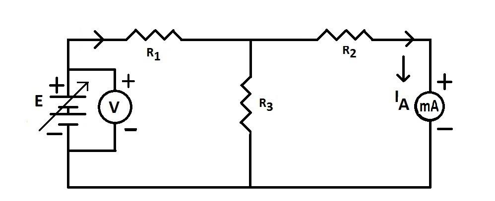
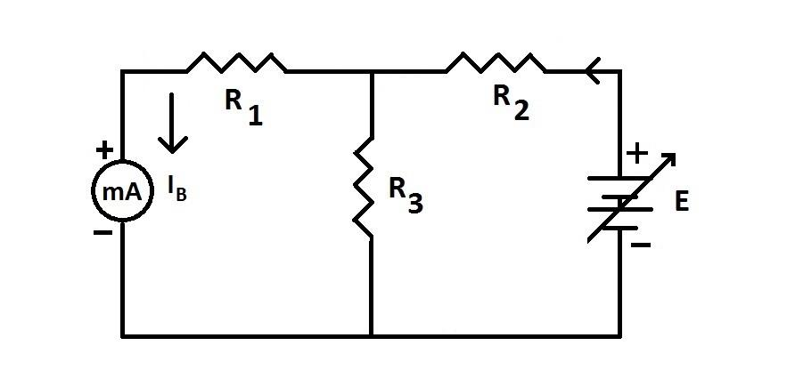

# Reciprocity Theorem — 3D First-Person Web Lab

[](https://devesh-thetechguy.github.io/reciprocity-3d-lab/)
[](https://github.com/Devesh-TheTechGuy/reciprocity-3d-lab/actions/workflows/deploy.yml)
[](./LICENSE)
[](https://threejs.org)
[](https://vite.dev)
[](https://www.typescriptlang.org)
[](https://developer.mozilla.org/docs/Web/API/WebGL2RenderingContext)

An interactive, first-person 3D simulation of the school-lab experiment **"To Verify
the Reciprocity Theorem"**. Walk up to the bench, patch the circuit with real patch
cords, and read live instrument values produced by an actual circuit solver —
entirely in the browser, with no installs or plug-ins.

**Live:** <https://devesh-thetechguy.github.io/reciprocity-3d-lab/>

## Contents

[Overview](#overview) · [Features](#features) · [Getting started](#getting-started) ·
[Controls](#controls) · [The experiment](#the-experiment) ·
[Architecture](#architecture) · [Deployment](#deployment) · [Roadmap](#roadmap) ·
[License](#license)

## Overview

The lab reproduces the procedure of the printed practical: wire the T-network as
Figure 1(a) and record `I_A`, rewire it as Figure 1(b) and record `I_B`, then show
`I_A = I_B`. Every reading comes from the same physics the textbook uses, so the
numbers agree with theory instead of being scripted.

- **A real circuit solver.** A modified nodal analysis (MNA) solver evaluates the
  live netlist, so any wiring — correct or not — yields a physically consistent
  result.
- **Hands-on interaction.** Aim and click to run a cord; drag-to-snap between brass
  binding posts; right-click (or press and hold, on touch) to unplug.
- **Evidence, not animation.** A state machine recognises the Figure 1
  arrangements, populates the observation table, and issues a verification verdict.

## Features

| Area | What's included |
| --- | --- |
| **Simulation** | Lab room, wooden bench, reciprocity kit (`R1`–`R3`, brass binding posts), variable DC source, two digital multimeters, Verlet-simulated patch cords |
| **Physics** | Netlist extraction from the live wiring graph and an MNA solver; live `E`, `V` and `I` readouts |
| **Wiring** | Raycast picking, drag-to-snap cords, several cords per terminal, automatic Figure 1(a)/1(b) detection |
| **Experiment flow** | Figure 1(a) → 1(b) state machine, Table 1 observation records, verification verdict, runtime resistor swap |
| **Presentation** | ACES tone mapping, PMREM image-based lighting from a CC0 HDRI, SSAO + bloom post-processing, a 2D circuit-map schematic, synthesised WebAudio cues |
| **Performance** | Quality presets (high / medium / low) with an adaptive governor driven by measured frame time |
| **Mobile** | On-screen walk pad, drag-to-look, long-press to unplug, and a dedicated phone layout |

## Getting started

**Prerequisites:** Node.js `^20.19.0 || >=22.12.0` (required by Vite 8) and a
WebGL2-capable browser.

```bash
npm install
npm run dev          # http://localhost:5173
npm run build        # type-check (tsc, strict) + production bundle -> dist/
npm run preview      # serve the built bundle
npm run build:pages  # production build targeting the GitHub Pages sub-path
```

> **Windows:** if `node` and `npm` are not on `PATH`, run
> `$env:Path = 'C:\Program Files\nodejs\;' + $env:Path` first.

## Controls

**Desktop**

| Action | Input |
| --- | --- |
| Orbit / zoom (overview) | drag / scroll |
| Enter first-person | **Enter the lab** |
| Move | `W` `A` `S` `D` — hold `Shift` to run |
| Patch a cord | aim at a terminal, left-click, drag, release on another terminal to snap |
| Unplug | right-click a terminal |
| Release the cursor | `Esc` |

**Touch**

| Action | Input |
| --- | --- |
| Walk | on-screen direction pad |
| Look around | drag on an empty area |
| Patch a cord | drag from one terminal to another |
| Unplug | press and hold a plugged terminal |
| Return to the overview | **Overview** |

Several cords may share a single terminal — both the source and the voltmeter reach
`T1`, exactly as the figure requires.

## The experiment

**Aim.** To verify the reciprocity theorem.

**Apparatus.** Reciprocity-theorem kit, patch cords, digital multimeter.

**Theory.** In a passive, linear, bilateral, time-invariant network, interchanging
an ideal voltage source and an ideal ammeter does not change the ammeter reading:

```
I_A = I_B = E · R3 / (R1·R2 + R2·R3 + R1·R3)

Transfer resistance:  R_T = (R1·R2 + R2·R3 + R1·R3) / R3
```

<p align="center">
  
  
</p>
<p align="center"><em>Figure 1 — the two arrangements the experiment compares.</em></p>

**Kit topology.** The board already contains the T-network; students patch in the
source and the meters:

```
T1 (A top) ── R1 ── C1 ── R2 ── T3 (B top)
                     │
                    R3
                     │
T2 (rail) ────────  T5 ────────  T4 (rail)      <- common bottom rail
```

| Run | Source `E` | Voltmeter `V` | Milliammeter `mA` |
| --- | --- | --- | --- |
| Figure 1(a) | `T1` / `T2` | `T1` / `T2` | `T3` / `T4` → reads `I_A` |
| Figure 1(b) | `T3` / `T4` | `T3` / `T4` | `T1` / `T2` → reads `I_B` |

Figure 1 shows a voltmeter and a milliammeter at the same time, but the apparatus
list specifies a single *Digital Multimeter*. The same instrument model is therefore
instantiated twice, exactly as the printed practical does.

## Architecture

```
src/
  main.ts            bootstrap: engine + room + kit + camera rig + UI
  core/              renderer and animation loop, post-processing, quality governor
  scene/             room, lab table, lighting, HDRI environment
  interaction/       camera rig (orbit -> first-person), wiring tool
  kit/               board, resistors, terminals, DC source, multimeter, cords
  cords/             Verlet cord simulation
  state/wiring.ts    live wiring graph and Figure 1 detection
  physics/           circuit model (nodes and branches) + MNA solver
  experiment/        component values and the Figure 1 flow state machine
  ui/                HUD, readouts, observation table, circuit map, walk pad
  audio/             synthesised WebAudio cues (no audio assets)
```

| Layer | Technology |
| --- | --- |
| Language | TypeScript, strict mode, type-checked with `noEmit` |
| Build | Vite 8 |
| 3D | three.js r187 on WebGL2 |
| Rendering | ACES filmic tone mapping, PCF shadows, MSAA, SSAO and bloom through `EffectComposer` |
| Lighting | PMREM-processed HDRI (CC0) with a hemisphere fill and a shadow-casting sun |
| Physics | Purpose-built MNA solver and Verlet cords — no physics-engine dependency |

## Deployment

Pushing to `main` publishes the site to GitHub Pages via
[`.github/workflows/deploy.yml`](./.github/workflows/deploy.yml). The workflow
installs with `npm ci`, runs `npm run build:pages` — the production build with
`--base=/reciprocity-3d-lab/`, so the bundle and the HDRI resolve under the project
sub-path — and deploys the resulting `dist/` artifact. It can also be started by
hand from the **Actions** tab.

## Roadmap

| Milestone | Scope | Status |
| --- | --- | --- |
| **M0** | Project scaffold — Vite + TypeScript + three.js | ✅ Shipped |
| **M1** | Lab room and camera rig — orbit → first-person walk | ✅ Shipped |
| **M2** | Reciprocity kit, Verlet patch cords, drag-and-snap wiring | ✅ Shipped |
| **M3** | Physics — netlist + MNA solver, live readouts | ✅ Shipped |
| **M4** | Experiment flow — Figure 1(a) → 1(b), observation table and verdict | ✅ Shipped |
| **M5** | Polish — HDRI, post-processing, sound, circuit map, performance, mobile/touch | ✅ Shipped |

[`PLAN.md`](./PLAN.md) holds the full engineering plan, and
[`PROGRESS.md`](./PROGRESS.md) records the detailed build history.

## License

Released under the [Apache License 2.0](./LICENSE).

## Acknowledgements

- [three.js](https://threejs.org) — 3D rendering.
- [Vite](https://vite.dev) — build tooling and dev server.
- [Poly Haven](https://polyhaven.com) — the CC0 studio HDRI used for image-based
  lighting.
- Figure 1 and the experiment text were extracted from the source practical
  document and are retained under [`docs/reference/`](./docs/reference).


